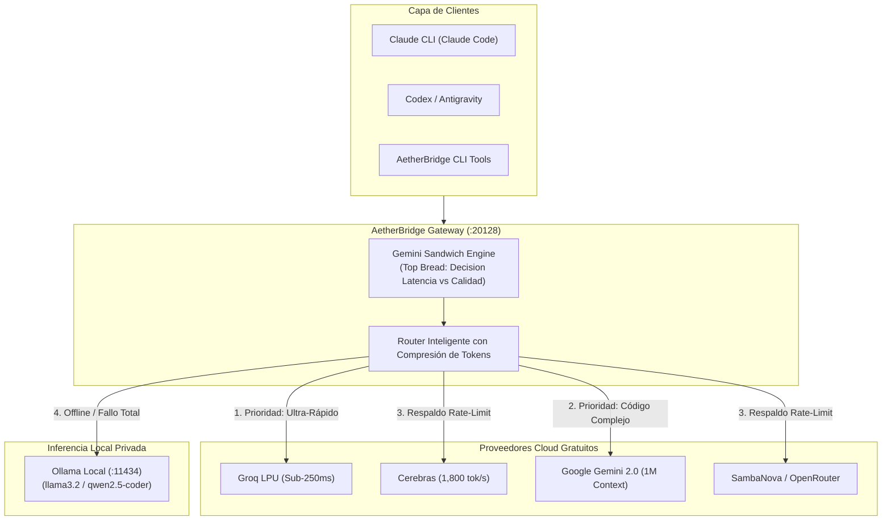

# 🌉 AetherBridge

### Universal AI Democratization Gateway & Multi-Model Orchestrator
*Zero-Cost, Ultra-Resilient AI Infrastructure Unifying +300 Free Cloud Frontier Models & Local Offline LLMs for Claude CLI, Codex, and Antigravity.*

[](LICENSE)
[-brightgreen.svg)](#4-proveedores-cloud-con-tiers-gratuitos-generosos)
[](#catálogo-de-modelos)
[](CONTRIBUTING.md)
[-lightgrey.svg)](#requisitos-del-sistema)

---

> **¿Cansado de pagar suscripciones mensuales de $20–$40 USD por cada herramienta de IA o de quedarte bloqueado por límites de cuota?**  
> **AetherBridge** es un puente y orquestador universal de código abierto que transforma tu máquina local en una central de inteligencia artificial. Enruta dinámicamente tus clientes de desarrollo (**Claude CLI / Claude Code**, **Codex**, **Antigravity**) hacia los tiers gratuitos oficiales de los mayores proveedores del mundo (**Google Gemini**, **Groq LPU**, **Cerebras**, **SambaNova**) y commuta automáticamente a tus modelos locales (**Ollama**) si se agota la cuota o te quedas sin conexión a internet.

> [!TIP]
> 👤 **¿Es tu primera vez o no tienes experiencia técnica previa con la terminal?**  
> Consulta la [**Guía Rápida para Principiantes (Paso a Paso)**](GUIA_PARA_PRINCIPIANTES.md).  
> 💻 **¿Usas Windows (Huawei, Lenovo, Dell, HP, etc.)?**  
> Consulta la sección dedicada en la [**Guía de Principiantes para Windows**](GUIA_PARA_PRINCIPIANTES.md#-guía-rápida-para-usuarios-de-windows-huawei-lenovo-hp-dell-etc) (¡100% nativo, sin necesidad de WSL ni Linux!).  
> 🤖 **¿Quieres que tu asistente de IA lo instale y configure todo por ti en 3 minutos?**  
> Copia directamente el [**Prompt Maestro de Autodespliegue**](PROMPT_MAESTRO.md).

---

## 📑 Tabla de Contenidos

1. [¿Qué es AetherBridge y cómo funciona?](#1-qué-es-aetherbridge-y-cómo-funciona)
2. [Arquitectura del Sistema & Protocolo Sándwich](#2-arquitectura-del-sistema--protocolo-sándwich)
3. [Requisitos del Sistema e Instalación de Dependencias](#3-requisitos-del-sistema-e-instalación-de-dependencias)
4. [Despliegue en 3 Minutos: Tu Agente como SysAdmin](#4-despliegue-en-3-minutos-tu-agente-como-sysadmin)
5. [Catálogo Maestro de Modelos por Cliente (OmniRoute + Ollama)](#5-catálogo-maestro-de-modelos-por-cliente-omniroute--ollama)
6. [Cableado de Clientes (Claude CLI, Claude Desktop, Codex y Antigravity)](#6-cableado-de-clientes-claude-cli-claude-desktop-codex-y-antigravity)
7. [Directiva de Transparencia Obligatoria (Banners para Claude)](#7-directiva-de-transparencia-obligatoria-banners-para-claude)
8. [La Solución Definitiva: El Fin de Reparar Claude a Diario](#8-la-solución-definitiva-el-fin-de-reparar-claude-a-diario)
9. [El Toolkit de AetherBridge (Scripts Clave)](#9-el-toolkit-de-aetherbridge-scripts-clave)
10. [Proveedores Cloud con Tiers Gratuitos Generosos](#10-proveedores-cloud-con-tiers-gratuitos-generosos)
11. [Matriz de Resiliencia y Fallback Automático](#11-matriz-de-resiliencia-y-fallback-automático)
12. [Preguntas Frecuentes, Seguridad y Tokens Locales](#12-preguntas-frecuentes-seguridad-y-tokens-locales)
13. [Licencia y Contribución](#13-licencia-y-contribución)

---

## 1. ¿Qué es AetherBridge y cómo funciona?

AetherBridge actúa como la **capa de abstracción y orquestación inteligente** que une tres piezas fundamentales:

```
┌─────────────────────────────────────────────────────────────┐
│                       AETHERBRIDGE                          │
│         (Orquestador, Scripts CLI, Protocolo Sándwich, MCP) │
└──────────────┬──────────────────────────────┬───────────────┘
               │                              │
               ▼                              ▼
┌──────────────────────────────┐┌─────────────────────────────┐
│  MOTOR GATEWAY: OMNIROUTE    ││  NODO LOCAL: OLLAMA         │
│  (Proxy local en :20128)     ││  (Motor offline en :11434)  │
│  - Traduce OpenAI / Claude   ││  - Llama 3.2, Qwen Coder    │
│  - Enruta a Groq, Gemini...  ││  - 100% privado en tu disco │
└──────────────────────────────┘└─────────────────────────────┘
```

- **AetherBridge:** Es el repositorio y suite de herramientas que coordina la orquestación Sándwich, el servidor Model Context Protocol (MCP), las pruebas de diagnóstico y los scripts de automatización.
- **OmniRoute (`omniroute`):** Es el demonio gateway local de alto rendimiento que corre en segundo plano (`localhost:20128`), traduciendo formatos de mensajes (OpenAI compatible y Anthropic Messages API), comprimiendo prompts y gestionando balanceos de carga.
- **Ollama (`ollama`):** Es el motor de inferencia local (`localhost:11434`) que garantiza privacidad total y resiliencia offline cuando no hay internet.

---

## 2. Arquitectura del Sistema & Protocolo Sándwich

### Diagrama de Enrutamiento



### 🥪 El Paradigma de la Arquitectura Sándwich
1. **Pan Superior (Evaluador Inteligente - Gemini):** Evalúa el objetivo analizando la compensación entre **Calidad de Respuesta** y **Latencia**:
   - *¿Máxima Velocidad?* Delega a chips LPU en la nube (**Groq / Cerebras** a +1,000 tok/s).
   - *¿Código Complejo?* Delega a **Claude 3.7 / 3.5 Sonnet** o **Qwen 2.5 Coder**.
   - *¿Razonamiento Lógico y Matemáticas?* Delega a **DeepSeek R1**.
   - *¿Contexto Gigante (hasta 1M tokens)?* Delega a **Gemini 2.0 Pro / Flash**.
   - *¿Privacidad u Offline?* Delega a **Ollama Local**.
2. **Ingrediente Central (Especialista):** La inferencia se ejecuta con costo $0 en el modelo óptimo.
3. **Pan Inferior (Auditor y Validador):** Audita la respuesta, valida la sintaxis y la presenta limpia al usuario.

---

## 3. Requisitos del Sistema e Instalación de Dependencias

### Requisitos Mínimos
- **Sistema Operativo:**
  - **Windows:** Windows 10 o Windows 11 (**100% Nativo** vía PowerShell/Terminal, o con WSL2).
  - **macOS:** Apple Silicon (M1/M2/M3/M4) o Intel.
  - **Linux:** Ubuntu, Debian, Fedora, Arch, etc.
- **Node.js:** Versión 18 o superior.
- **Python:** Versión 3.10 o superior.

### Instalación de Componentes Base (Paso único)

- **En Windows (PowerShell / Terminal):**
  ```powershell
  # 1. Instalar Ollama y Node.js con winget (o descarga directa desde sus webs)
  winget install Ollama.Ollama
  winget install OpenJS.NodeJS

  # 2. Instalar el motor Gateway OmniRoute
  npm install -g omniroute
  ```

- **En macOS (Terminal):**
  ```bash
  # 1. Instalar Ollama y Node con Homebrew
  brew install ollama node

  # 2. Instalar el motor Gateway OmniRoute
  npm install -g omniroute
  ```

- **En Linux (Bash):**
  ```bash
  # 1. Instalar Ollama
  curl -fsSL https://ollama.com/install.sh | sh

  # 2. Instalar el motor Gateway OmniRoute
  npm install -g omniroute
  ```

---

## 4. Despliegue en 3 Minutos: Tu Agente como SysAdmin

No necesitas configurar servidores manualmente. Gracias al **Prompt Maestro**, tu propio agente de desarrollo (**Antigravity**, **Codex**, o **Claude Code**) actuará como ingeniero DevOps en tu computadora:

1. **Clona este repositorio:**
   ```bash
   git clone https://github.com/paulosintel/AetherBridge.git
   cd AetherBridge
   ```

2. **Prepara tus claves gratuitas:**
   - En Windows (PowerShell): `Copy-Item api_keys.env.example api_keys.env`
   - En macOS / Linux: `cp api_keys.env.example api_keys.env`
   *(Añade al menos 1 clave de [Google AI Studio](https://aistudio.google.com/app/apikey) o [Groq](https://console.groq.com/keys)).*

3. **Ejecuta el Prompt Maestro:**  
   Abre el archivo [`PROMPT_MAESTRO.md`](PROMPT_MAESTRO.md), copia su contenido y pégalo en tu agente.  
   El agente:
   - Verificará los servicios y descargará un modelo local (`llama3.2`).
   - Levantará el gateway en el puerto `20128`.
   - Conectará tus clientes de desarrollo automáticamente.

---

---

## 5. Catálogo Maestro de Modelos por Cliente (OmniRoute + Ollama)

AetherBridge unifica dos mundos: **más de 1,000 modelos frontera en la nube a costo $0** y **modelos locales ultrarrápidos y 100% privados** que corren en tu propio disco duro.

### 🌐 A. Modelos Frontera en la Nube (Vía OmniRoute Gateway en `:20128`)

| Identificador de Modelo | Tipo / Proveedor | Especialidad Técnica | Velocidad / Ventana |
| :--- | :--- | :--- | :--- |
| **`claude-3-7-sonnet`** | Anthropic (Cloud) | Razonamiento híbrido de última generación y codificación premier | Alta precisión |
| **`claude-3-5-sonnet-latest`** | Anthropic (Cloud) | El estándar indiscutido de ingeniería de software y refactorización | Contexto 200k |
| **`auto/claude-opus`** | Anthropic (Cloud) | Macro-arquitectura de sistemas complejos y síntesis profunda | Máxima abstracción |
| **`deepseek-r1`** | DeepSeek (Cloud) | Campeón mundial en matemáticas, algoritmos y lógica formal | Cadena de razonamiento |
| **`deepseek-v3`** | DeepSeek (Cloud) | Modelo general de frontera para programación y chat | Ultra-eficiente |
| **`gemini/gemini-3.1-flash-lite`** | Google AI Studio | Ventana colosal de contexto, lectura masiva de repositorios enteros | **1 Millón de tokens** |
| **`gemini-2.0-pro`** | Google AI Studio | Razonamiento multimodal y análisis de código en proyectos masivos | **1 Millón de tokens** |
| **`groq/qwen/qwen3.8-27b`** | Groq LPU | Inferencia instantánea en hardware acelerado | **Sub-250ms (+1,000 tok/s)** |
| **`llama-3.3-70b`** | Cerebras LPU | El modelo abierto más rápido del mundo en chip de oblea | **+1,800 tokens/seg** |

#### 🔀 Cascadas Inteligentes (Smart Combos sin Costo)
- **`auto/best-coding`**: Conmuta automáticamente entre Claude 3.7 Sonnet, Qwen 2.5 Coder y Gemini Flash para programar.
- **`auto/best-reasoning`**: Cascada optimizada para demostraciones matemáticas y algoritmos (DeepSeek R1 / o3-mini).
- **`auto/fast`**: Cascada ultra-veloz entre chips LPU de Groq y Cerebras.
- **`auto/best-free`**: Enruta exclusivamente a través de proveedores con límite gratuito perpetuo.

---

### 💻 B. Modelos Locales y 100% Privados (Vía Ollama en `:11434`)
*No requieren internet, no tienen cuotas ni límites, y jamás comparten tus archivos o código:*

| Modelo Local | Optimización | Especialidad | Rendimiento Local (Apple Silicon / PC) |
| :--- | :--- | :--- | :--- |
| **`qwen2.5-coder:3b`** | Local (Ollama) | Programación, depuración, sintaxis de código y scripts | **42 tokens/segundo** |
| **`deepseek-r1:1.5b`** | Local (Ollama) | Razonamiento lógico paso a paso con bloques `<think>` | **75 tokens/segundo** |
| **`llama3.2:latest`** | Local (Ollama) | Redacción, resúmenes, traducción y asistencia general | Inferencia instantánea |

---

## 6. Cableado de Clientes (Claude CLI, Claude Desktop, Codex y Antigravity)

Todos tus entornos de desarrollo pueden consumir este ecosistema unificado al mismo tiempo:

### A. Para Claude CLI (Claude Code)
Claude CLI permite redefinir el endpoint base mediante `ANTHROPIC_BASE_URL`.

- **En Windows (PowerShell - Persistente para tu usuario):**
  ```powershell
  [System.Environment]::SetEnvironmentVariable('ANTHROPIC_BASE_URL', 'http://localhost:20128', 'User')
  [System.Environment]::SetEnvironmentVariable('ANTHROPIC_AUTH_TOKEN', 'sk-aetherbridge', 'User')
  ```

- **En macOS / Linux (Añadir a `~/.zshrc` o `~/.bashrc`):**
  ```bash
  export ANTHROPIC_BASE_URL="http://localhost:20128"
  export ANTHROPIC_AUTH_TOKEN="sk-aetherbridge"
  ```

- **O directamente en tu archivo de configuración de Claude (`~/.claude/settings.json` o `%USERPROFILE%\.claude\settings.json`):**
  ```json
  {
    "env": {
      "ANTHROPIC_BASE_URL": "http://localhost:20128",
      "ANTHROPIC_AUTH_TOKEN": "sk-aetherbridge"
    }
  }
  ```

---

### B. Para Claude Escritorio (Claude Desktop Oficial)
Aunque la aplicación gráfica oficial de Claude tiene cerrado el endpoint principal, **soporta de forma nativa el Model Context Protocol (MCP)**.  
Con nuestro puente MCP [`scripts/omniroute_mcp_bridge.js`](scripts/omniroute_mcp_bridge.js), Claude Desktop obtiene acceso instantáneo a todas las herramientas:

1. Abre el archivo de configuración de Claude Desktop:
   - **En macOS:** `~/Library/Application Support/Claude/claude_desktop_config.json`
   - **En Windows:** `%APPDATA%\Claude\claude_desktop_config.json`
2. Pega la configuración del servidor MCP:
   ```json
   {
     "mcpServers": {
       "aetherbridge": {
         "command": "node",
         "args": [
           "/ABSOLUTE/PATH/TO/AetherBridge/scripts/omniroute_mcp_bridge.js"
         ],
         "env": {
           "OMNIROUTE_URL": "http://127.0.0.1:20128",
           "OMNIROUTE_TOKEN": "sk-aetherbridge",
           "OLLAMA_URL": "http://127.0.0.1:11434"
         }
       }
     }
   }
   ```
3. Reinicia Claude Desktop. Verás un icono de martillo 🔨 con las herramientas:
   - `sandwich_orchestration`: Ejecuta la orquestación Sándwich completa.
   - `ask_deepseek_r1_reasoning`: Resuelve problemas lógicos y matemáticos.
   - `ask_gemini_frontier`: Pasa documentos de 1M de tokens a Gemini 3.1 Flash Lite.
   - `ask_ollama_local`: Ejecuta consultas offline en `qwen2.5-coder:3b` o `deepseek-r1:1.5b`.
   - `ask_omniroute_council`: Consulta cualquiera de los +1,000 modelos del catálogo.

---

### C. Para Codex (Escritorio / CLI)
En la configuración de proveedores de Codex:
- **Provider:** Custom OpenAI Compatible
- **Base URL:** `http://localhost:20128/v1`
- **API Key:** `sk-aetherbridge`
- **Model:** `auto/best-coding`, `auto/best-reasoning`, `claude-3-7-sonnet`, o cualquier modelo del catálogo.

---

### D. Para Antigravity IDE
Antigravity se integra directamente mediante el servidor MCP [`scripts/omniroute_mcp_bridge.js`](scripts/omniroute_mcp_bridge.js) y la habilidad nativa del Consejo Multi-Modelo [`omniroute-council`](.agents/skills/omniroute-council/SKILL.md).

---

## 7. Directiva de Transparencia Obligatoria (Banners para Claude)

Para que siempre sepas con certeza **qué modelo está contestando**, si se activó el **Protocolo Sándwich**, o si estás operando en **Ollama local**, se ha configurado la siguiente directiva en [`CLAUDE.md`](CLAUDE.md) (y puedes pegarla en las "Instrucciones Personalizadas" de Claude Desktop):

> **Instrucción de Transparencia:**  
> Al inicio de cada respuesta sustancial o al cambiar de motor/herramienta, incluye un banner en la primera línea:
> - `> 🌉 **[AetherBridge]** Modelo: **Claude 3.7 / 3.5 Sonnet** | Backend: **OmniRoute Cloud Gateway**`
> - `> 🌉 **[AetherBridge]** Protocolo: **Sándwich (Orquestador Gemini + Especialista DeepSeek R1)**`
> - `> 🌉 **[AetherBridge]** Modelo Local: **Qwen 2.5 Coder 3B** | Backend: **Ollama Local (Offline / Privado)**`
> - `> 🌉 **[AetherBridge]** Respaldo Activo: **Fallback automático activado por cuota hacia Groq LPU**`

---

## 8. La Solución Definitiva: El Fin de Reparar Claude a Diario

> **¿Por qué antes era una pesadilla y tenías que reparar Claude casi todos los días?**

1. **Sesiones de Terminal Efímeras:**  
   Al ejecutar `export ANTHROPIC_BASE_URL=...` en la terminal, la configuración se borraba al cerrar la ventana o reiniciar el equipo. Al día siguiente, Claude intentaba conectarse a Anthropic oficial y pedía suscripción.
2. **Caída por Límites de Cuota (Error HTTP 429):**  
   Si una clave gratuita de Groq o Gemini se saturaba temporalmente, Claude CLI abortaba de inmediato con un error fatal y quedaba inutilizable.
3. **Muerte Silenciosa del Gateway:**  
   Si el proceso de OmniRoute se detenía en segundo plano, el puerto 20128 se cerraba y Claude arrojaba error de conexión de red `ECONNREFUSED`.
4. **Desactualización de Modelos:**  
   Cuando los proveedores actualizaban versiones de modelos (ej. Gemini 1.5 a 2.0 / 3.1), las llamadas hardcodeadas quedaban obsoletas arrojando errores 404.

### 🛡️ Cómo AetherBridge Erradica este Problema de Raíz:

1. **Persistencia del Gateway (Auto-Arranque con el Sistema):**  
   - En macOS: Se incluye el demonio LaunchAgent `com.omniroute.serve` que inicia el gateway automáticamente al encender el ordenador.
   - En Windows: Se ejecuta como servicio persistente o tarea programada.
2. **Configuración en Archivo de Usuario (No Variables Volátiles):**  
   AetherBridge escribe de forma fija en `~/.claude/settings.json` o `%USERPROFILE%\.claude\settings.json`. Aunque reinicies tu máquina o abras 50 terminales distintas, Claude CLI siempre sabrá conectarse a AetherBridge.
3. **Cascada Inmortal Anti-429 (Matriz de Resiliencia):**  
   OmniRoute intercepta cualquier error de cuota. Si Groq se satura, salta en 50 milisegundos a Cerebras; si Cerebras se satura, a Gemini; si se corta internet, salta a Ollama local. **Claude jamás recibe un error 429 ni se congela.**
4. **Auto-Actualizador Autónomo de Catálogo (`auto_update_catalog.py`):**  
   Un demonio en segundo plano escanea cada 6 horas el catálogo mundial, detecta nuevos lanzamientos de modelos y los inyecta en los perfiles de tus clientes sin que muevas un dedo.
5. **Diagnóstico y Reparación en 1 Solo Clic:**  
   Si alguna vez tienes dudas, ejecutas:
   ```bash
   python scripts/verify_setup.py
   # En Windows: doble clic en scripts\verify_setup.bat
   ```
   El script audita los 5 puntos críticos en 2 segundos y te indica exactamente la solución.

---

## 9. El Toolkit de AetherBridge (Scripts Clave)

La carpeta [`scripts/`](scripts/) incluye utilidades de nivel de producción listas para usar:

### 1. Diagnóstico del Sistema Universal (`scripts/verify_setup.py`)
Verifica con un solo comando que Ollama, el gateway, tus claves API y Claude CLI estén en verde en cualquier sistema:
```bash
# Universal (Windows, macOS, Linux):
python scripts/verify_setup.py

# En Windows: También puedes hacer doble clic en scripts\verify_setup.bat o ejecutar .\scripts\verify_setup.ps1
# En macOS/Linux: También puedes ejecutar ./scripts/verify_setup.sh
```

### 2. Consulta Rápida Multi-Modelo (`scripts/aether_consult.py`)
Envía consultas instantáneas a modelos de élite desde tu terminal sin abrir navegadores:
```bash
# Inferencia a hiper-velocidad con LPUs (Groq/Cerebras)
python scripts/aether_consult.py -m fast "Explica la diferencia entre proceso e hilo"

# Razonamiento matemático con DeepSeek R1
python scripts/aether_consult.py -m r1 "Demuestra si la suma de dos números impares es par"

# Inferencia 100% privada sin conexión a internet (Ollama)
python scripts/aether_consult.py -m local "Resume este texto en 3 puntos"
```
*(Nota en macOS/Linux: Puedes usar `python3` en lugar de `python`).*

### 3. Motor Sándwich Gemini (`scripts/gemini_sandwich.py`)
Ejecuta la orquestación multi-modelo con evaluación automática de latencia vs calidad:
```bash
python scripts/gemini_sandwich.py --mode auto "Refactoriza este algoritmo para complejidad O(n)"
```

### 4. Servidor Model Context Protocol (`scripts/omniroute_mcp_bridge.js`)
Permite que herramientas como **Antigravity** o **Claude Desktop** utilicen estos más de 1,000 modelos como herramientas (*tools*) nativas.

### 5. Actualizador Autónomo de Catálogo (`scripts/auto_update_catalog.py`)
Sincroniza y detecta nuevos modelos lanzados a nivel global cada 6 horas, inyectándolos en los perfiles de tus agentes automáticamente.

---

## 10. Proveedores Cloud con Tiers Gratuitos Generosos

Obtén tus credenciales gratuitas oficiales (la mayoría no requieren tarjeta de crédito):

| Proveedor | Especialidad | Enlace a Clave Gratuita |
| :--- | :--- | :--- |
| **Google AI Studio** | Gemini 2.0 Pro/Flash (Contexto masivo 1M) | [aistudio.google.com](https://aistudio.google.com/app/apikey) |
| **Groq Cloud** | Inferencia LPU ultra-rápida (Llama 3.3 70B) | [console.groq.com](https://console.groq.com/keys) |
| **Cerebras Cloud** | +1,800 tokens/segundo con capa gratuita | [cloud.cerebras.ai](https://cloud.cerebras.ai/) |
| **SambaNova Cloud** | Modelos open source a máxima escala | [cloud.sambanova.ai](https://cloud.sambanova.ai/) |
| **OpenRouter** | Cientos de modelos con etiqueta `:free` | [openrouter.ai](https://openrouter.ai/keys) |
| **Together AI / DeepInfra** | Créditos iniciales de bienvenida | [together.ai](https://api.together.xyz/) |

---

## 11. Matriz de Resiliencia y Fallback Automático

```mermaid
flowchart LR
    A[Petición de Código] --> B{¿Groq Disponible?}
    B -- Sí --> C[Respuesta en sub-300ms]
    B -- Cuota 429 --> D{¿Gemini 2.0 / Cerebras?}
    D -- Sí --> E[Respuesta con éxito]
    D -- Sin Internet --> F[Ollama Local (Offline)]
    F --> G[Respuesta privada sin conexión]
```

Si una empresa aplica un límite de tasa (*rate limit*), AetherBridge conmuta silenciosamente al siguiente proveedor compatible. Si tu conexión a internet se interrumpe, el sistema delega en tus modelos locales de Ollama sin interrumpir tu flujo de trabajo.

---

## 12. Preguntas Frecuentes, Seguridad y Tokens Locales

### ¿Mis claves API están seguras?
**Sí, absolutamente.** AetherBridge y el gateway se ejecutan **100% en tu máquina local (`localhost`)**. Tus claves nunca viajan a servidores de terceros; se envían exclusivamente de forma directa y cifrada por HTTPS a las APIs oficiales de Google, Groq, etc. Además, el archivo `api_keys.env` está explícitamente ignorado en `.gitignore`.

### ¿Puedo usar tanto Claude CLI como la aplicación oficial de Claude Escritorio?
**¡Sí, totalmente!**  
- **Claude CLI (Terminal):** Se conecta como tu copiloto de ingeniería mediante la variable `ANTHROPIC_BASE_URL` apuntando al puerto local `20128`.
- **Claude Escritorio (App Oficial):** Se conecta mediante el protocolo MCP utilizando nuestro puente [`scripts/omniroute_mcp_bridge.js`](scripts/omniroute_mcp_bridge.js), lo que te permite consultar a DeepSeek R1, Gemini 3.1 con 1M tokens, y tus modelos locales de Ollama con un clic desde el chat oficial de Claude.

### ¿Qué ocurre si no configuro todas las claves?
AetherBridge funciona con las claves que tengas. Incluso si solo configuras Google AI Studio o únicamente usas Ollama local sin internet, el sistema se adaptará y enrutará según los recursos disponibles.

---

## 13. Licencia y Contribución

Este proyecto está liberado bajo la **[Licencia MIT](LICENSE)**. Creemos en una inteligencia artificial abierta, accesible y democratizada para todos los desarrolladores del mundo.

¿Quieres contribuir con nuevos proveedores, modelos o mejoras de resiliencia? Lee nuestra [Guía de Contribución](CONTRIBUTING.md) y envía tu Pull Request.

---

**Creado con ❤️ por [paulosintel](https://github.com/paulosintel) y la comunidad global de AetherBridge.**
