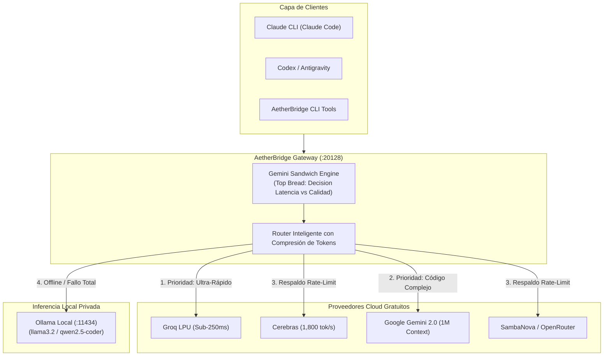

# 🌉 AetherBridge

### Universal AI Democratization Gateway & Multi-Model Orchestrator
*Zero-Cost, Ultra-Resilient AI Infrastructure Unifying +300 Free Cloud Frontier Models & Local Offline LLMs for Claude CLI, Codex, and Antigravity.*

[](LICENSE)
[-brightgreen.svg)](#4-proveedores-cloud-con-tiers-gratuitos-generosos)
[](#catálogo-de-modelos)
[](CONTRIBUTING.md)
[-lightgrey.svg)](#requisitos-del-sistema)

---

> **¿Cansado de pagar suscripciones mensuales de $20–$40 USD por cada herramienta de IA o de quedarte bloqueado por límites de cuota?**  
> **AetherBridge** es un puente y orquestador universal de código abierto que transforma tu máquina local en una central de inteligencia artificial. Enruta dinámicamente tus clientes de desarrollo (**Claude CLI / Claude Code**, **Codex**, **Antigravity**) hacia los tiers gratuitos oficiales de los mayores proveedores del mundo (**Google Gemini**, **Groq LPU**, **Cerebras**, **SambaNova**) y commuta automáticamente a tus modelos locales (**Ollama**) si se agota la cuota o te quedas sin conexión a internet.

> [!TIP]
> 👤 **¿Es tu primera vez o no tienes experiencia técnica previa con la terminal?**  
> Consulta la [**Guía Rápida para Principiantes (Paso a Paso)**](GUIA_PARA_PRINCIPIANTES.md).  
> 🤖 **¿Quieres que tu asistente de IA lo instale y configure todo por ti en 3 minutos?**  
> Copia directamente el [**Prompt Maestro de Autodespliegue**](PROMPT_MAESTRO.md).

---

## 📑 Tabla de Contenidos

1. [¿Qué es AetherBridge y cómo funciona?](#1-qué-es-aetherbridge-y-cómo-funciona)
2. [Arquitectura del Sistema & Protocolo Sándwich](#2-arquitectura-del-sistema--protocolo-sándwich)
3. [Requisitos del Sistema e Instalación de Dependencias](#3-requisitos-del-sistema-e-instalación-de-dependencias)
4. [Despliegue en 3 Minutos: Tu Agente como SysAdmin](#4-despliegue-en-3-minutos-tu-agente-como-sysadmin)
5. [Cableado de Clientes (Claude CLI y Codex)](#5-cableado-de-clientes-claude-cli-y-codex)
6. [El Toolkit de AetherBridge (Scripts Clave)](#6-el-toolkit-de-aetherbridge-scripts-clave)
7. [Proveedores Cloud con Tiers Gratuitos Generosos](#7-proveedores-cloud-con-tiers-gratuitos-generosos)
8. [Matriz de Resiliencia y Fallback Automático](#8-matriz-de-resiliencia-y-fallback-automático)
9. [Preguntas Frecuentes, Seguridad y Tokens Locales](#9-preguntas-frecuentes-seguridad-y-tokens-locales)
10. [Licencia y Contribución](#10-licencia-y-contribución)

---

## 1. ¿Qué es AetherBridge y cómo funciona?

AetherBridge actúa como la **capa de abstracción y orquestación inteligente** que une tres piezas fundamentales:

```
┌─────────────────────────────────────────────────────────────┐
│                       AETHERBRIDGE                          │
│         (Orquestador, Scripts CLI, Protocolo Sándwich, MCP) │
└──────────────┬──────────────────────────────┬───────────────┘
               │                              │
               ▼                              ▼
┌──────────────────────────────┐┌─────────────────────────────┐
│  MOTOR GATEWAY: OMNIROUTE    ││  NODO LOCAL: OLLAMA         │
│  (Proxy local en :20128)     ││  (Motor offline en :11434)  │
│  - Traduce OpenAI / Claude   ││  - Llama 3.2, Qwen Coder    │
│  - Enruta a Groq, Gemini...  ││  - 100% privado en tu disco │
└──────────────────────────────┘└─────────────────────────────┘
```

- **AetherBridge:** Es el repositorio y suite de herramientas que coordina la orquestación Sándwich, el servidor Model Context Protocol (MCP), las pruebas de diagnóstico y los scripts de automatización.
- **OmniRoute (`omniroute`):** Es el demonio gateway local de alto rendimiento que corre en segundo plano (`localhost:20128`), traduciendo formatos de mensajes (OpenAI compatible y Anthropic Messages API), comprimiendo prompts y gestionando balanceos de carga.
- **Ollama (`ollama`):** Es el motor de inferencia local (`localhost:11434`) que garantiza privacidad total y resiliencia offline cuando no hay internet.

---

## 2. Arquitectura del Sistema & Protocolo Sándwich

### Diagrama de Enrutamiento



### 🥪 El Paradigma de la Arquitectura Sándwich
1. **Pan Superior (Evaluador Inteligente - Gemini):** Evalúa el objetivo analizando la compensación entre **Calidad de Respuesta** y **Latencia**:
   - *¿Máxima Velocidad?* Delega a chips LPU en la nube (**Groq / Cerebras** a +1,000 tok/s).
   - *¿Código Complejo?* Delega a **Claude 3.7 / 3.5 Sonnet** o **Qwen 2.5 Coder**.
   - *¿Razonamiento Lógico y Matemáticas?* Delega a **DeepSeek R1**.
   - *¿Contexto Gigante (hasta 1M tokens)?* Delega a **Gemini 2.0 Pro / Flash**.
   - *¿Privacidad u Offline?* Delega a **Ollama Local**.
2. **Ingrediente Central (Especialista):** La inferencia se ejecuta con costo $0 en el modelo óptimo.
3. **Pan Inferior (Auditor y Validador):** Audita la respuesta, valida la sintaxis y la presenta limpia al usuario.

---

## 3. Requisitos del Sistema e Instalación de Dependencias

### Requisitos Mínimos
- **Sistema Operativo:** macOS (Apple Silicon M1/M2/M3/M4 o Intel), Linux (Ubuntu, Debian, Fedora, Arch), o Windows con WSL2.
- **Node.js:** Versión 18 o superior.
- **Python:** Versión 3.10 o superior.

### Instalación de Componentes Base (Paso único)

```bash
# 1. Instalar el motor Gateway OmniRoute
npm install -g omniroute

# 2. Instalar Ollama para soporte offline
# En macOS:
brew install ollama
# En Linux:
curl -fsSL https://ollama.com/install.sh | sh
```

---

## 4. Despliegue en 3 Minutos: Tu Agente como SysAdmin

No necesitas configurar servidores manualmente. Gracias al **Prompt Maestro**, tu propio agente de desarrollo (**Antigravity**, **Codex**, o **Claude Code**) actuará como ingeniero DevOps en tu computadora:

1. **Clona este repositorio:**
   ```bash
   git clone https://github.com/paulosintel/AetherBridge.git
   cd AetherBridge
   ```

2. **Prepara tus claves gratuitas:**
   ```bash
   cp api_keys.env.example api_keys.env
   ```
   *(Añade al menos 1 clave de [Google AI Studio](https://aistudio.google.com/app/apikey) o [Groq](https://console.groq.com/keys)).*

3. **Ejecuta el Prompt Maestro:**  
   Abre el archivo [`PROMPT_MAESTRO.md`](PROMPT_MAESTRO.md), copia su contenido y pégalo en tu agente.  
   El agente:
   - Verificará los servicios y descargará un modelo local (`llama3.2`).
   - Levantará el gateway en el puerto `20128`.
   - Conectará tus clientes de desarrollo automáticamente.

---

## 5. Cableado de Clientes (Claude CLI y Codex)

### A. Para Claude CLI (Claude Code)
Claude CLI admite de forma nativa la redirección de endpoint mediante la variable de entorno `ANTHROPIC_BASE_URL`.

Añade a tu archivo `~/.zshrc` o `~/.bashrc`:
```bash
export ANTHROPIC_BASE_URL="http://localhost:20128"
export ANTHROPIC_AUTH_TOKEN="sk-aetherbridge"
```

O en la configuración de Claude (`~/.claude/settings.json`):
```json
{
  "env": {
    "ANTHROPIC_BASE_URL": "http://localhost:20128",
    "ANTHROPIC_AUTH_TOKEN": "sk-aetherbridge"
  }
}
```

> [!NOTE]
> **¿Qué es `sk-aetherbridge`?**  
> Al correr de forma local en tu máquina (`localhost`), AetherBridge no requiere una contraseña remota. Puedes usar cualquier identificador de token (por ejemplo `sk-aetherbridge` o `omniroute-secret-key-local`). Funciona como una llave local transparente.

### B. Para Codex (Escritorio / CLI)
En la configuración de modelos de Codex:
- **Provider:** Custom OpenAI Compatible
- **Base URL:** `http://localhost:20128/v1`
- **API Key:** `sk-aetherbridge`
- **Model:** `auto/best-coding` o el modelo que prefieras del catálogo.

---

## 6. El Toolkit de AetherBridge (Scripts Clave)

La carpeta [`scripts/`](scripts/) incluye utilidades de nivel de producción listas para usar:

### 1. Diagnóstico del Sistema (`scripts/verify_setup.sh`)
Verifica con un solo comando que Ollama, el gateway, tus claves API y Claude CLI estén en verde:
```bash
./scripts/verify_setup.sh
```

### 2. Consulta Rápida Multi-Modelo (`scripts/aether_consult.py`)
Envía consultas instantáneas a modelos de élite desde tu terminal sin abrir navegadores:
```bash
# Inferencia a hiper-velocidad con LPUs (Groq/Cerebras)
python3 scripts/aether_consult.py -m fast "Explica la diferencia entre proceso e hilo"

# Razonamiento matemático con DeepSeek R1
python3 scripts/aether_consult.py -m r1 "Demuestra si la suma de dos números impares es par"

# Inferencia 100% privada sin conexión a internet (Ollama)
python3 scripts/aether_consult.py -m local "Resume este texto en 3 puntos"
```

### 3. Motor Sándwich Gemini (`scripts/gemini_sandwich.py`)
Ejecuta la orquestación multi-modelo con evaluación automática de latencia vs calidad:
```bash
python3 scripts/gemini_sandwich.py --mode auto "Refactoriza este algoritmo para complejidad O(n)"
```

### 4. Servidor Model Context Protocol (`scripts/omniroute_mcp_bridge.js`)
Permite que herramientas como **Antigravity** o **Claude Desktop** utilicen estos más de 300 modelos como herramientas (*tools*) nativas.

### 5. Actualizador Autónomo de Catálogo (`scripts/auto_update_catalog.py`)
Sincroniza y detecta nuevos modelos lanzados a nivel global cada 6 horas, inyectándolos en los perfiles de tus agentes automáticamente.

---

## 7. Proveedores Cloud con Tiers Gratuitos Generosos

Obtén tus credenciales gratuitas oficiales (la mayoría no requieren tarjeta de crédito):

| Proveedor | Especialidad | Enlace a Clave Gratuita |
| :--- | :--- | :--- |
| **Google AI Studio** | Gemini 2.0 Pro/Flash (Contexto masivo 1M) | [aistudio.google.com](https://aistudio.google.com/app/apikey) |
| **Groq Cloud** | Inferencia LPU ultra-rápida (Llama 3.3 70B) | [console.groq.com](https://console.groq.com/keys) |
| **Cerebras Cloud** | +1,800 tokens/segundo con capa gratuita | [cloud.cerebras.ai](https://cloud.cerebras.ai/) |
| **SambaNova Cloud** | Modelos open source a máxima escala | [cloud.sambanova.ai](https://cloud.sambanova.ai/) |
| **OpenRouter** | Cientos de modelos con etiqueta `:free` | [openrouter.ai](https://openrouter.ai/keys) |
| **Together AI / DeepInfra** | Créditos iniciales de bienvenida | [together.ai](https://api.together.xyz/) |

---

## 8. Matriz de Resiliencia y Fallback Automático

```mermaid
flowchart LR
    A[Petición de Código] --> B{¿Groq Disponible?}
    B -- Sí --> C[Respuesta en sub-300ms]
    B -- Cuota 429 --> D{¿Gemini 2.0 / Cerebras?}
    D -- Sí --> E[Respuesta con éxito]
    D -- Sin Internet --> F[Ollama Local (Offline)]
    F --> G[Respuesta privada sin conexión]
```

Si una empresa aplica un límite de tasa (*rate limit*), AetherBridge conmuta silenciosamente al siguiente proveedor compatible. Si tu conexión a internet se interrumpe, el sistema delega en tus modelos locales de Ollama sin interrumpir tu flujo de trabajo.

---

## 9. Preguntas Frecuentes, Seguridad y Tokens Locales

### ¿Mis claves API están seguras?
**Sí, absolutamente.** AetherBridge y el gateway se ejecutan **100% en tu máquina local (`localhost`)**. Tus claves nunca viajan a servidores de terceros; se envían exclusivamente de forma directa y cifrada por HTTPS a las APIs oficiales de Google, Groq, etc. Además, el archivo `api_keys.env` está explícitamente ignorado en `.gitignore`.

### ¿Por qué usamos Claude CLI en vez de la app oficial de Claude Escritorio?
La aplicación de escritorio oficial de Anthropic está cerrada de fábrica para usar únicamente los servidores de pago de Anthropic. En cambio, **Claude CLI (Claude Code)** respeta el estándar `ANTHROPIC_BASE_URL`, permitiendo redirigir todas las peticiones a AetherBridge y trabajar con cualquier modelo sin pagar suscripciones fijas.

### ¿Qué ocurre si no configuro todas las claves?
AetherBridge funciona con las claves que tengas. Incluso si solo configuras Google AI Studio o únicamente usas Ollama local sin internet, el sistema se adaptará y enrutará según los recursos disponibles.

---

## 10. Licencia y Contribución

Este proyecto está liberado bajo la **[Licencia MIT](LICENSE)**. Creemos en una inteligencia artificial abierta, accesible y democratizada para todos los desarrolladores del mundo.

¿Quieres contribuir con nuevos proveedores, modelos o mejoras de resiliencia? Lee nuestra [Guía de Contribución](CONTRIBUTING.md) y envía tu Pull Request.

---

**Creado con ❤️ por [paulosintel](https://github.com/paulosintel) y la comunidad global de AetherBridge.**
